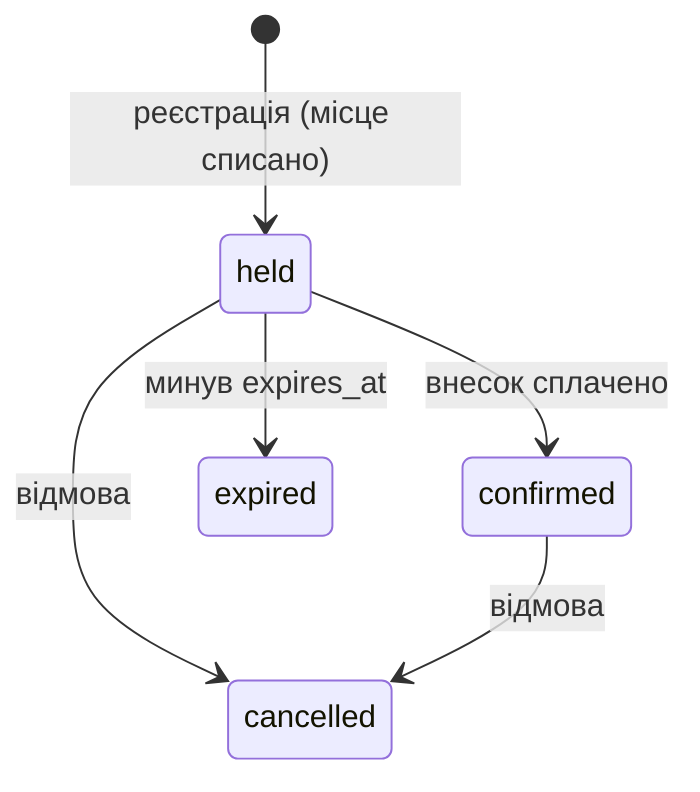

# C24 Ігрові турніри

Команда: `<Литвинов Ю. О. ІТІНФ-23-1>`, `<Константінов О. К. ІТІНФ-23-1>`, `<Алєксандрова Л. А. ІТІНФ-23-1>`.

Гравці реєструються на турнір з обмеженою кількістю місць. Головна операція Web — `POST /v1/registrations`.

## Запуск

Потрібен Docker Desktop. Команди у Git Bash.

```bash
cp .env.example .env
docker compose up --build
```

Запускаються postgres, міграції (Flyway), app-a, app-b, nginx на http://localhost:8080 і сервіс DPC `api` на http://localhost:8090 (токен `Authorization: Bearer dev-token`).

Перевірка Web (у другому терміналі):

```bash
bash scripts/check-web.sh
```

Тестові дані: гравці `00000000-0000-0000-0000-000000000001` … `…000000000010` (заголовок `X-User-Id`), турнір Dota 2 на 64 місця `10000000-0000-0000-0000-000000000001`, турнір CS2 на 2 місця `10000000-0000-0000-0000-000000000002`.

Клієнт Web (О1.7) — окремо, не в Compose:

```bash
py -m http.server 5500 -d client
```

Відкрити http://localhost:5500: обрати гравця й турнір, ввести нікнейм, «Зареєструватися». Результат або помилка (Problem Details) показуються під кнопкою.

Засіб перевірки викладача: `checks.yaml` (розділи `web` і `dpc`), ролі маршрутів позначено `x-course` в `openapi.yaml`.

## Модель Web (О1.1)

Сутності: `tournament` (турнір), `registration` (реєстрація гравця), `match` (матч), `app_user` (гравець або організатор).



Матч: `scheduled → finished`.

Інваріанти:

1. Учасників не більше, ніж місць: `0 ≤ available ≤ slots`.
2. Один гравець — одна активна реєстрація на турнір.
3. Результат матчу фіксується один раз.

Параметри: 64 місця, внесок 5000 копійок (50,00 UAH), утримання місця 15 хвилин, нікнейм 3–32 символи.

## DPC (ЛР1)

Спільний ресурс — `player_rating` (rating, version). Інваріант: одночасні результати матчів не перезаписують зміни рейтингу одне одного. Переможець отримує d очок Ело, переможений втрачає d, тому сума рейтингів 10 гравців завжди 15000, а сума `version` = 2 × кількість застосованих результатів. `GET /v1/player-rating/{id}` повертає це як `invariant_ok`.

`POST /v1/match-results` → 202 + Location. Стан запиту (`state`): `queued → processing → done | rejected | failed` (`rejected` — гра не підтвердила результат або результат матчу вже записано). Читання: `GET /v1/match-results/{id}`, `GET /v1/player-rating/{id}`.

- Черга — `asyncio.Queue(maxsize=QUEUE_CAPACITY)` у `dpc/main.py`. Порожня черга: обробник чекає в `await queue.get()`, корутина спить і не займає процесор, `put` будить одного з тих, хто чекає. Немає місця — одразу 429 + `Retry-After: 1`, запит у чергу не потрапляє.
- Рівно `WORKERS` обробників (корутин), їх кількість видно в `GET /health`. Повільна перевірка на ігровому сервері — `await asyncio.sleep` 100–500 мс, приймання не блокується.
- Захист ресурсу — `dpc/rating.py`. Критична секція — `SELECT … FOR UPDATE` рядків двох гравців до COMMIT, повільна перевірка виконується до неї. `RATING_SYNC=none` вимикає блокування (лише для досліду).

Досліди (потрібен `py -m pip install httpx`):

| Дослід | Команда | Результат |
| --- | --- | --- |
| О1.2: повна черга, затримка `/health` | `py loadtest/overload.py` | 100 клієнтів, 60 с, QUEUE_CAPACITY=50, WORKERS=4: 202 — 836, 429 — 7663, черга 50/50; `/health` p50 = 1,1 мс, **p95 = 1,4 мс**, p99 = 1,7 мс |
| О1.4: втрачене оновлення | `bash loadtest/lost-update.sh` | окрема тестова база (`-p c24-exp`), 500 результатів між 3 гравцями, WORKERS=8. `none`: сума рейтингів **15216 ≠ 15000**, сума version 728 ≠ 954, `invariant_ok: false`. `lock`: **15000 = 15000**, 942 = 942, `invariant_ok: true` |

Середовище дослідів: AMD Ryzen 7 9800X3D (8 ядер, 16 логічних), 31 ГБ ОЗП, Docker Desktop 29.8, Windows 11.

## Внесок учасників

| Учасник | Що зробив |
| --- | --- |
| Литвинов Ю. О. | репозиторій, Docker Compose, nginx, міграції, сервер Web, `openapi.yaml`, модель Web |
| Константінов О. К. | сервіс DPC: приймання запитів, обмежена черга, пул обробників (О1.1–О1.3), дослід О1.2 |
| Алєксандрова Л. А. | захист рейтингу (О1.4, `dpc/rating.py`), дослід втраченого оновлення, клієнт Web (О1.7), `checks.yaml` і позначки `x-course` |
