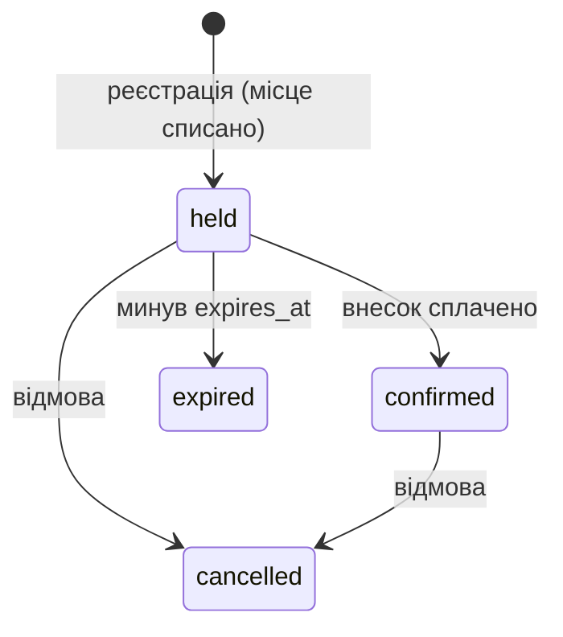

# C24 Ігрові турніри

Команда: `<Литвинов Ю. О. ІТІНФ-23-1>`, `<Константінов О. К. ІТІНФ-23-1>`, `<Алєксандрова Л. А. ІТІНФ-23-1>`.

Гравці реєструються на турнір з обмеженою кількістю місць. Головна операція Web — `POST /v1/registrations`.

## Запуск

Потрібен Docker Desktop. Команди у Git Bash.

```bash
cp .env.example .env
docker compose up --build
```

Запускаються postgres, міграції (Flyway), app-a, app-b, nginx на http://localhost:8080.

Перевірка Web (у другому терміналі):

```bash
bash scripts/check-web.sh
```

Тестові дані: гравці `00000000-0000-0000-0000-000000000001` … `…000000000010` (заголовок `X-User-Id`), турнір Dota 2 на 64 місця `10000000-0000-0000-0000-000000000001`, турнір CS2 на 2 місця `10000000-0000-0000-0000-000000000002`.

## Модель Web (О1.1)

Сутності: `tournament` (турнір), `registration` (реєстрація гравця), `match` (матч), `app_user` (гравець або організатор).



Матч: `scheduled → finished`.

Інваріанти:

1. Учасників не більше, ніж місць: `0 ≤ available ≤ slots`.
2. Один гравець — одна активна реєстрація на турнір.
3. Результат матчу фіксується один раз.

Параметри: 64 місця, внесок 5000 копійок (50,00 UAH), утримання місця 15 хвилин, нікнейм 3–32 символи.

## Внесок учасників

| Учасник | Що зробив |
| --- | --- |
| Литвинов Ю. О. | репозиторій, Docker Compose, nginx, міграції, сервер Web, `openapi.yaml`, модель Web |
| Константінов О. К. | сервіс DPC, клієнт Web |

