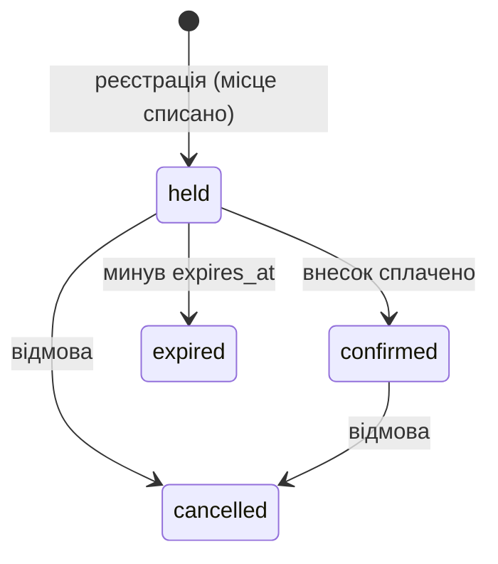

# C24 Ігрові турніри

Команда: `<Литвинов Ю. О. ІТІНФ-23-1>`, `<Константінов О. К. ІТІНФ-23-1>`, `<Алєксандрова Л. А. ІТІНФ-23-1>`, `<Богдан Юрій ІТІНФ-23-1>`.

Гравці реєструються на турнір з обмеженою кількістю місць. Головна операція Web — `POST /v1/registrations`.

## Запуск

Потрібен Docker Desktop. Команди у Git Bash.

```bash
cp .env.example .env
docker compose up --build
```

Запускаються postgres, міграції (Flyway), app-a, app-b, nginx на http://localhost:8080 і сервіс DPC `api` на http://localhost:8090 (токен `Authorization: Bearer dev-token`).

Перевірка Web (у другому терміналі):

```bash
bash scripts/check-web.sh
```

Тестові дані: гравці `00000000-0000-0000-0000-000000000001` … `…000000000010` (заголовок `X-User-Id`), турнір Dota 2 на 64 місця `10000000-0000-0000-0000-000000000001`, турнір CS2 на 2 місця `10000000-0000-0000-0000-000000000002`.

Клієнт Web (О1.7) — окремо, не в Compose:

```bash
py -m http.server 5500 -d client
```

Відкрити http://localhost:5500: обрати гравця й турнір, ввести нікнейм, «Зареєструватися». Результат або помилка (Problem Details) показуються під кнопкою.

Засіб перевірки викладача: `checks.yaml` (розділи `web` і `dpc`), ролі маршрутів позначено `x-course` в `openapi.yaml`.

## Модель Web (О1.1)

Сутності: `tournament` (турнір), `registration` (реєстрація гравця), `match` (матч), `app_user` (гравець або організатор).



Матч: `scheduled → finished`.

Інваріанти:

1. Учасників не більше, ніж місць: `0 ≤ available ≤ slots`.
2. Один гравець — одна активна реєстрація на турнір.
3. Результат матчу фіксується один раз.

Параметри: 64 місця, внесок 5000 копійок (50,00 UAH), утримання місця 15 хвилин, нікнейм 3–32 символи.

## DPC (ЛР1)

Спільний ресурс — `player_rating` (rating, version). Інваріант: одночасні результати матчів не перезаписують зміни рейтингу одне одного. Переможець отримує d очок Ело, переможений втрачає d, тому сума рейтингів 10 гравців завжди 15000, а сума `version` = 2 × кількість застосованих результатів. `GET /v1/player-rating/{id}` повертає це як `invariant_ok`.

`POST /v1/match-results` → 202 + Location. Стан запиту (`state`): `queued → processing → done | rejected | failed` (`rejected` — гра не підтвердила результат або результат матчу вже записано). Читання: `GET /v1/match-results/{id}`, `GET /v1/player-rating/{id}`.

- Черга — `asyncio.Queue(maxsize=QUEUE_CAPACITY)` у `dpc/main.py`. Порожня черга: обробник чекає в `await queue.get()`, корутина спить і не займає процесор, `put` будить одного з тих, хто чекає. Немає місця — одразу 429 + `Retry-After: 1`, запит у чергу не потрапляє.
- Рівно `WORKERS` обробників (корутин), їх кількість видно в `GET /health`. Повільна перевірка на ігровому сервері — `await asyncio.sleep` 100–500 мс, приймання не блокується.
- Захист ресурсу — `dpc/rating.py`. Критична секція — `SELECT … FOR UPDATE` рядків двох гравців до COMMIT, повільна перевірка виконується до неї. `RATING_SYNC=none` вимикає блокування (лише для досліду).

Досліди (потрібен `py -m pip install httpx`):

| Дослід | Команда | Результат |
| --- | --- | --- |
| О1.2: повна черга, затримка `/health` | `py loadtest/overload.py` | 100 клієнтів, 60 с, QUEUE_CAPACITY=50, WORKERS=4: 202 — 836, 429 — 7663, черга 50/50; `/health` p50 = 1,1 мс, **p95 = 1,4 мс**, p99 = 1,7 мс |
| О1.4: втрачене оновлення | `bash loadtest/lost-update.sh` | окрема тестова база (`-p c24-exp`), 500 результатів між 3 гравцями, WORKERS=8. `none`: сума рейтингів **15216 ≠ 15000**, сума version 728 ≠ 954, `invariant_ok: false`. `lock`: **15000 = 15000**, 942 = 942, `invariant_ok: true` |

Середовище дослідів: AMD Ryzen 7 9800X3D (8 ядер, 16 логічних), 31 ГБ ОЗП, Docker Desktop 29.8, Windows 11.

## DPC (ЛР2) — паралельний розрахунок

Функція картки N(t) = N₀ + N₁·cos(πt/84) на [0; 168] — гравце-години за тиждень. Навчальні припущення: N₀ = 1200 гравців у середньому, N₁ = 400 (змінні `N0`, `N1`). Еталон — через первісну N₀t + (84N₁/π)·sin(πt/84): на [0; 168] це 168·N₀ = 201600. Допуск — відносна похибка 10⁻⁹.

`POST /v1/compute` з `a`, `b`, `n`, `workers`, `method` (`midpoint`, `trapezoid`, `simpson`), `order` (`forward`, `reverse`), `mode` (`local`, `lock`, `none`) повертає `value`, `reference`, `error`, `wall_s`, `workers` і розклад часу; `GET /v1/compute/{id}` — той самий результат. Код — `dpc/compute.py`.

Схема розрахунку: вузли методу (n для середніх прямокутників, n + 1 для трапецій і Сімпсона) діляться на `workers` суцільних частин без пропусків і перекриття; кожен процес `ProcessPoolExecutor` рахує локальну суму своєї частини; головний процес об'єднує суми й множить на h (h/3 для Сімпсона). Послідовна частина — запуск пулу, розподіл частин, об'єднання результатів і їх передавання між процесами.

| Пункт | Перевірка | Результат |
| --- | --- | --- |
| О2.1 | `py loadtest/compute_check.py` | n = 2·10⁶, усі 3 методи × 1, 2, 4 процеси: відносна похибка ≤ 2,6·10⁻¹⁴ ([results/compute-check.md](results/compute-check.md)) |
| О2.4 | той самий скрипт, `workers=4` | `none` (читання й запис спільної суми без блокування після кожних 200 вузлів): похибка 1250–1546, оновлення втрачаються; `lock` і `local`: похибка < 10⁻⁹, у межах допуску |
| О2.3 | `py loadtest/speedup.py --n 24000000 --runs 5` | таблиці нижче, сирі дані — `results/speedup-*.csv` |

О2.3. Метод середніх прямокутників, n = 24·10⁶, по 5 вимірювань; час — `wall_s` усередині сервісу: запуск пулу, розрахунок частин, передавання результатів, об'єднання. `compute` — найдовша частина, `overhead` — решта. 8 фізичних ядер, 16 логічних.

| p | T_p медіана, с | розкид, с | compute, с | overhead, с | S_p | E_p |
| --- | --- | --- | --- | --- | --- | --- |
| 1 | 1,289 | 0,046 | 1,247 | 0,043 | 1,00 | 1,00 |
| 2 | 0,710 | 0,063 | 0,657 | 0,050 | 1,81 | 0,91 |
| 4 | 0,408 | 0,033 | 0,355 | 0,054 | 3,16 | 0,79 |

Профілювання (`cProfile` головного процесу, [results/profile-cprofile.txt](results/profile-cprofile.txt); `py-spy` у Docker Desktop недобирав вибірки й падав на потоках, що завершуються): поза розрахунком час іде на запуск процесів пулу через forkserver (`_spawn_process`, `_launch`) і очікування їх завершення (`shutdown`, `join`). **Гіпотеза:** сталі ≈ 50 мс на запуск і зупинку пулу на кожен запит не зменшуються з p і обмежують прискорення. **Змінено один параметр** — `pool=warm` (пул створено заздалегідь), задача й точність ті самі:

| p | T_p медіана, с | розкид, с | compute, с | overhead, с | S_p | E_p |
| --- | --- | --- | --- | --- | --- | --- |
| 1 | 1,224 | 0,052 | 1,224 | 0,001 | 1,00 | 1,00 |
| 2 | 0,655 | 0,047 | 0,654 | 0,001 | 1,87 | 0,93 |
| 4 | 0,364 | 0,039 | 0,358 | 0,001 | 3,37 | 0,84 |

Висновок: гіпотеза підтвердилась частково. Накладні витрати впали з 43–54 мс до 1 мс, S₄ зросло з 3,16 до 3,37. Але сам розрахунок на 4 процесах прискорюється лише в 3,4 раза: друге обмеження — у самих обчисленнях (спільні ресурси ядер і частота процесора під навантаженням), його цей дослід не усуває.

## Внесок учасників

| Учасник | Що зробив |
| --- | --- |
| Литвинов Ю. О. | ЛР1: репозиторій, Docker Compose, nginx, міграції, сервер Web, `openapi.yaml`, модель Web. ЛР2: паралельний розрахунок і режими спільної суми (О2.1, О2.4, `dpc/compute.py`) |
| Константінов О. К. | ЛР1: сервіс DPC: приймання запитів, обмежена черга, пул обробників (О1.1–О1.3), дослід О1.2. ЛР2: вимірювання прискорення, профілювання, гіпотеза й повторні вимірювання (О2.3) |
| Алєксандрова Л. А. | ЛР1: захист рейтингу (О1.4, `dpc/rating.py`), дослід втраченого оновлення, клієнт Web (О1.7), `checks.yaml` і позначки `x-course` |
